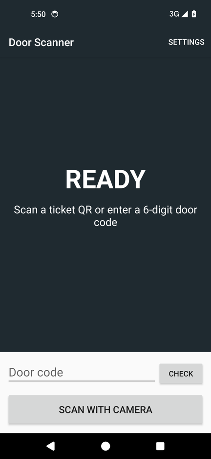
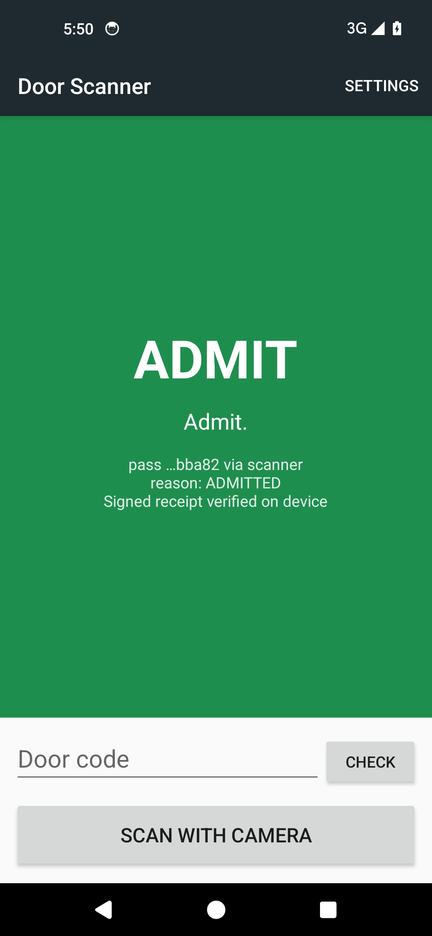
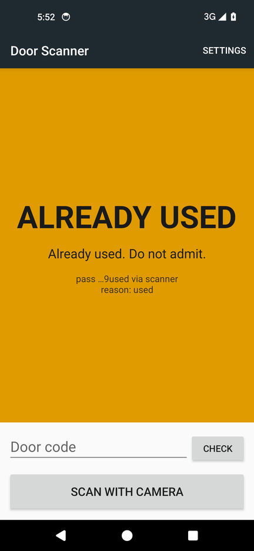
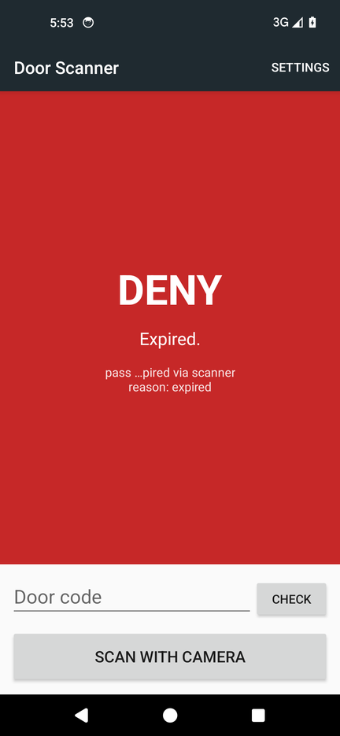

# affixio-door-scanner

A small Android app for checking single-use tickets at a door. It reads an AffixIO ticket QR code or a six-digit door code and asks the AffixIO API whether to let the person in. The first scan of a ticket admits. Any later scan of the same ticket, including a screenshot of the QR or the door code for that ticket, is refused.

It works with the built-in scanners on Android handhelds (Zebra, Honeywell, Datalogic, Sunmi, Urovo, Newland), with keyboard-style USB or Bluetooth scanners, and with the phone camera.

| Ready | Admit | Already used | Deny |
| --- | --- | --- | --- |
|  |  |  |  |

Screenshots from an Android 14 emulator, with scans sent as Zebra DataWedge broadcasts and the API replies replayed from real responses.

## What it does

```
scan ──> QR link?  POST /v1/link/verify {link}  ──┐
     └─> 6 digits? POST /v1/otp/verify  {otp}   ──┤
                                                  v
                      POST /v1/gate/verify {circuit_id, proof, gate_id, mode: "consume"}
                                                  v
                   ADMIT (green) / ALREADY USED (amber) / DENY (red)
```

- `link/verify` and `otp/verify` look up the ticket. A `409` means the ticket has already been used.
- `gate/verify` with `mode: "consume"` spends the ticket's proof, so it can only admit once. A second consume returns `409 double_spend_detected`.
- The QR holds only a random token. No name, age or other personal data is in the code or shown on screen.
- With **signed receipt** on (the default), the app asks for an ML-DSA-65 attestation and checks the signature on the device against the public key from `GET /v1/attestation/public-key`. The signature check itself does not need the network.
- If the device is offline, or the API is unavailable or rate limited, the screen says **DO NOT ADMIT**. Once-only use can only be confirmed online.

These are the calls described in the [AffixIO quickstart, section 5](https://www.affix-io.com/docs/quickstart/) and the [OpenAPI schema](https://api.affix-io.com/openapi.json) (1.8.0).

## Quick start

1. Get an AffixIO API key from [AffixIO Studio](https://www.affix-io.com/). Use a separate key for door devices.
2. Build and install the app (see [Build](#build)).
3. Open **Settings** (top right). Paste the API key. Optionally set a **Gate ID**; if blank, the gate bound to each ticket is used.
4. Scan a ticket, or type a door code and tap **Check**.

Your ticket system issues tickets on its own server, with the same API key account:

```
POST /v1/circuits/ticket_age_entry/prove   -> proof_id
POST /v1/link/issue  {"proof_ref":"<proof_id>","gate_id":"main-door","ttl_seconds":45}  -> https_link for the QR
POST /v1/otp/issue   {"proof_ref":"<proof_id>","gate_id":"main-door"}                    -> six-digit door code
```

## Build

Requirements: JDK 17 and the Android SDK (platform 34). Android Studio works, or the command line:

```sh
git clone https://github.com/AffixIO/affixio-door-scanner.git
cd affixio-door-scanner
echo "sdk.dir=$ANDROID_HOME" > local.properties
./gradlew :core:test :app:assembleDebug
# APK: app/build/outputs/apk/debug/app-debug.apk
adb install app/build/outputs/apk/debug/app-debug.apk
```

For development only, you can put defaults in `local.properties`, which is git-ignored:

```properties
affixio.apiKey=your-key
affixio.gateId=main-door
```

Do not commit keys. Values typed in Settings take priority and are stored only in the app's private storage.

### Terminal check (no device)

The `core` module is plain Kotlin and has a command-line entry point:

```sh
AFFIX_API_KEY=your-key ./gradlew -q :core:run --args="https://www.affix-io.com/v/<token>"
AFFIX_API_KEY=your-key ./gradlew -q :core:run --args="123456"
```

For a usable exit code in scripts (0 means admitted), run `./gradlew :core:installDist` and use `core/build/install/core/bin/core`.

## How each scanner plugs in

The app listens for scans in three ways at once.

### 1. Broadcast intents (built-in handheld scanners)

Most Android handhelds can send each scan to the app in the foreground as a broadcast. The action names and extra keys below are the app's defaults. They can be changed in **Settings**, because they vary by model and firmware. Check them against your device's scanner settings.

| Maker | Where to set it on the device | Action | Extra with the barcode |
| --- | --- | --- | --- |
| Zebra | DataWedge profile, Intent output, delivery Broadcast. Or tap **Create Zebra DataWedge profile** in Settings. | `com.affixio.doorscanner.SCAN` | `com.symbol.datawedge.data_string` |
| Honeywell | Scanner settings, Data Processing, Data Intent | `com.honeywell.decode.intent.action.EDIT_DATA` | `data` |
| Datalogic | Scanner settings, Intent Wedge, broadcast | `com.datalogic.decodewedge.decode_action` | `com.datalogic.decode.intentwedge.barcode_string` |
| Sunmi | Scanner settings, output mode broadcast | `com.sunmi.scanner.ACTION_DATA_CODE_RECEIVED` | `data` |
| Urovo | Scanner settings, output mode Intent | `android.intent.ACTION_DECODE_DATA` | `barcode_string` |
| Newland | Scan settings, output mode broadcast | `nlscan.action.SCANNER_RESULT` | `SCAN_BARCODE1` |

The **Create Zebra DataWedge profile** button sends a DataWedge `SET_CONFIG` request (DataWedge 6.9 or later). It creates an `AffixIODoorScanner` profile tied to this app, with barcode input on, Intent output on (broadcast) and keystroke output off.

You can test the broadcast path without a scanner:

```sh
adb shell am broadcast -a com.affixio.doorscanner.SCAN \
  --es com.symbol.datawedge.data_string "https://www.affix-io.com/v/<token>"
```

### 2. Keyboard wedge

USB and Bluetooth scanners, and handhelds set to keystroke output, type the barcode followed by Enter. The app collects fast keystrokes and checks them when Enter arrives. It ignores them while the door code box has focus.

### 3. Camera

**Scan with camera** opens [ZXing Android Embedded](https://github.com/journeyapps/zxing-android-embedded) (Apache-2.0) for QR codes. It does not need Google Play services.

## Project layout

```
core/   Plain Kotlin: input parsing, API calls, ML-DSA-65 receipt check (BouncyCastle), CLI, tests
app/    Android app: scanner inputs, settings, status screen
```

`core` has unit tests for input parsing, every reply the door can get (admit, used, expired, unknown, bad key, rate limited, offline), and the receipt check against a real response captured from the API.

## Notes for production

- **The API key sits on the device.** Use a dedicated key per site so it can be revoked on its own, and use managed devices (kiosk mode, MDM). The alternative is to point **API base URL** at your own backend that adds the key and forwards the same three calls.
- **Online is required** to stop a ticket being used twice. The app never admits when it cannot reach the API.
- **Door codes** are consumed by `otp/verify`. A reused code returns "not recognised, expired or already used" rather than amber, because the API no longer finds it.
- The scan broadcast receiver is exported so that the device's scanner service can reach it. A forged broadcast can only trigger a check. The API decides.
- The screen never shows a full token or code, only the last few characters.

## Licence

MIT. See [LICENSE](LICENSE).

ZXing Android Embedded and ZXing are Apache-2.0. BouncyCastle is under the MIT-style Bouncy Castle licence.
